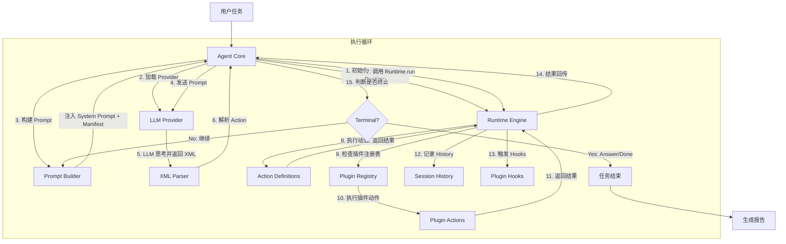
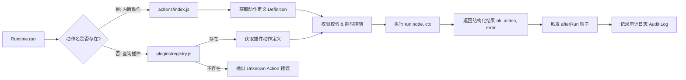
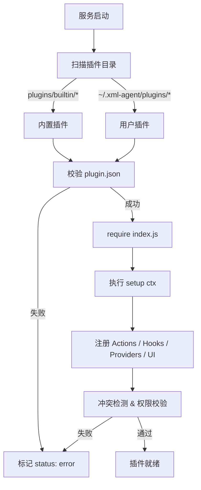
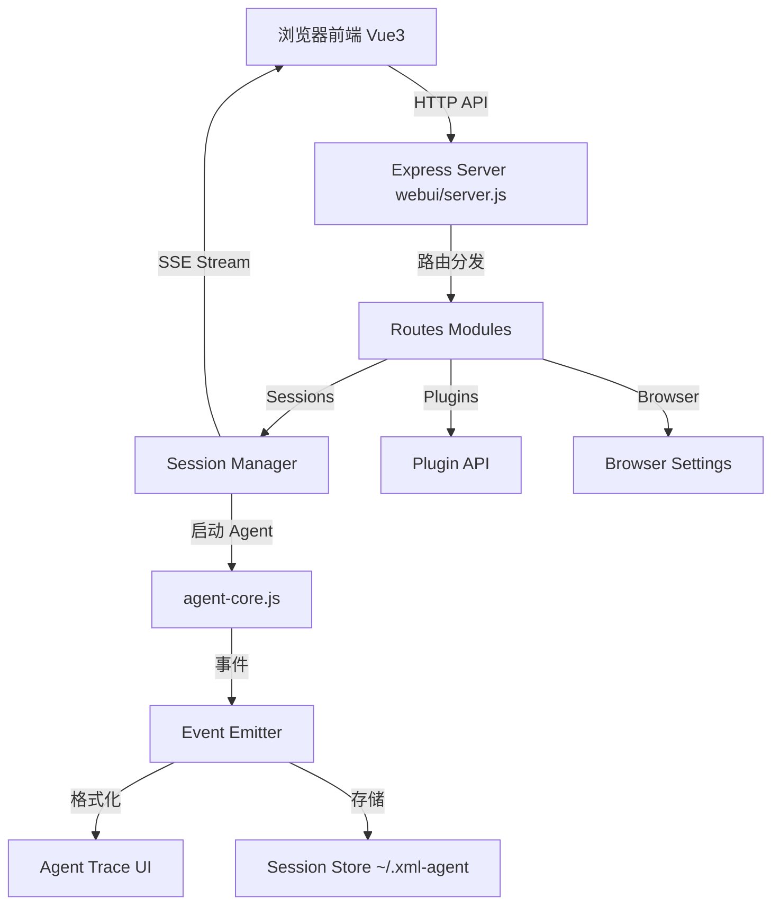

# XML Agent 架构流转图

本文档通过 Mermaid 流程图展示 XML Agent 各模块之间的交互与数据流转。

## 1. 整体执行流程 (Agent Core Loop)

## 2. 动作分发细节 (Runtime Dispatch)

## 3. 插件系统加载流程 (Plugin Lifecycle)

## 4. WebUI 与后端交互 (WebUI Architecture)

## 5. 关键模块职责说明

| 模块 | 职责 | 关键文件 |
| :--- | :--- | :--- |
| **Agent Core** | 任务编排、Prompt 构建、循环控制 | `agent-core.js` |
| **Agent Step** | 单轮闭环：发送 → 解析 → 执行 → 决定下一步 | `agent/step.js`, `agent/artifacts.js` |
| **Runtime** | 安全沙箱、动作分发、路径校验 | `runtime.js`, `actions/` |
| **Plugins** | 能力扩展、权限管理、审计日志 | `plugins/registry.js`（门面）, `plugins/registry/*.js`（加载/存储/执行/配置）, `plugins/sdk.js` |
| **Provider** | 模型适配、CDP 连接、会话管理 | `providers/registry.js`, `providers/browser-chat.js`, `providers/browser-agent.js` |
| **Capture** | 截图：平台分派、窗口枚举、子进程 | `capture/take-screenshot.js`, `capture/screenshot.js`, `capture/windows.js`, `capture/proc.js` |
| **Parser** | XML 语法解析、动作校验 | `parse/xml-parse.js` |
| **WebUI** | 用户界面、会话管理、实时反馈 | `webui/server.js`, `webui/frontend/` |

## 6. 大模块的拆分现状

超过 600 行的模块已按职责拆开，入口文件保持原有的导出面，调用方无需改动。

| 原模块 | 拆分后 | 说明 |
| :--- | :--- | :--- |
| `plugins/registry.js`（1311 行） | `registry.js`（门面 + 单例）+ `registry/{storage,loader,context,catalog,present,api,settings,invoke}.js` | 各 mixin 挂回 `PluginRegistry.prototype`，`this` 语义不变 |
| `capture/screenshot.js`（589 行） | `screenshot.js`（平台分派）+ `windows.js`（窗口枚举 / PowerShell）+ `proc.js`（子进程） | 平台差异隔离，工具函数从原文件继续 re-export |
| `agent-core.js`（491 行） | `agent-core.js`（循环与收尾）+ `agent/step.js`（单轮闭环）+ `agent/inputs.js`（入参归一化） | `run()` 只保留循环骨架 |

## 7. 数据流向总结

1. **输入**: 用户任务文本 + 可选图片 -> `Agent`
2. **思考**: `Agent` -> `Provider` (LLM) -> `XML Action`
3. **执行**: `XML Action` -> `Parser` -> `Runtime` -> `Actions/Plugins` -> `Workspace/OS`
4. **反馈**: `Result` -> `History` -> `Prompt Builder` -> `Provider` (下一轮)
5. **输出**: `Answer` -> `User` / `Report`

---
*注：本流程图基于 v1.1.0 版本架构绘制，反映了插件化重构后的模块关系。*
