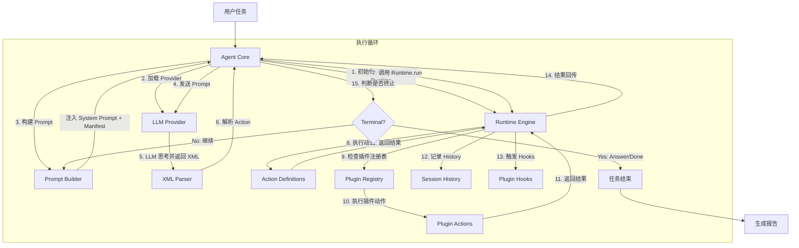
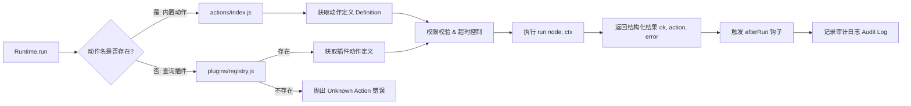
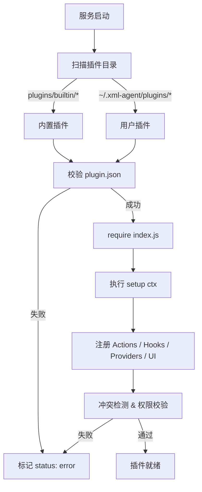
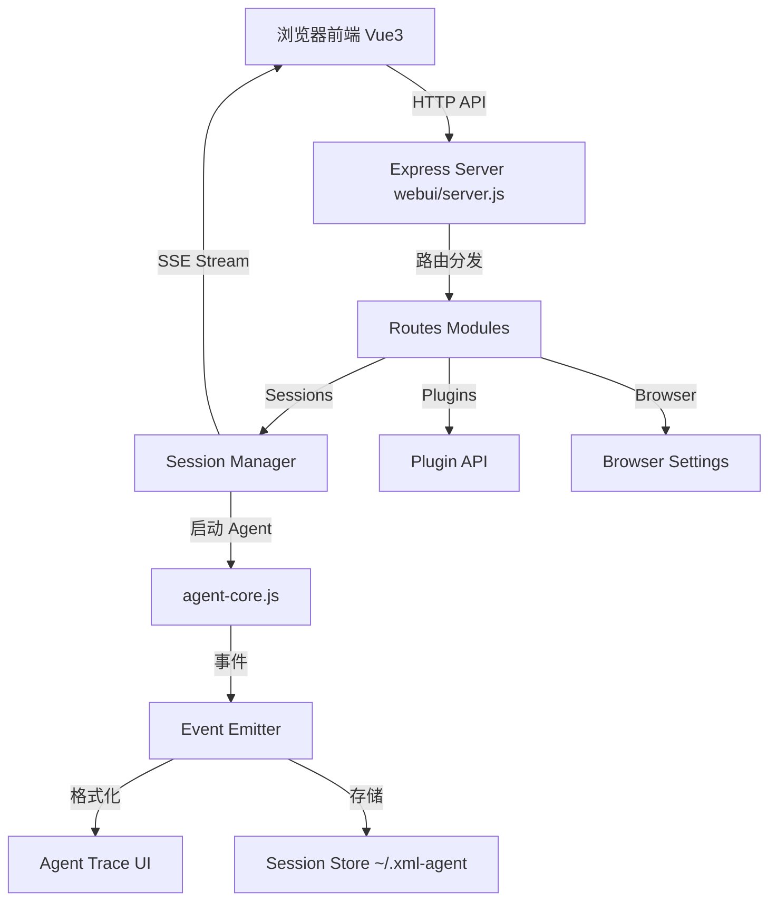

# XML Agent 架构流转图

本文档通过 Mermaid 流程图展示 XML Agent 各模块之间的交互与数据流转。

## 1. 整体执行流程 (Agent Core Loop)

## 2. 动作分发细节 (Runtime Dispatch)

## 3. 插件系统加载流程 (Plugin Lifecycle)

## 4. WebUI 与后端交互 (WebUI Architecture)

## 5. 关键模块职责说明

| 模块           | 职责                                           | 关键文件                                                                                        |
| :------------- | :--------------------------------------------- | :---------------------------------------------------------------------------------------------- |
| **Agent Core** | 任务编排、Prompt 构建、循环控制                | `agent-core.js`                                                                                 |
| **Agent Step** | 单轮闭环：发送 → 解析 → 执行 → 决定下一步      | `agent/step.js`, `agent/artifacts.js`                                                           |
| **Runtime**    | 安全沙箱、动作分发、路径校验、子进程登记与结束 | `runtime.js`, `actions/`, `processes/registry.js`                                               |
| **Plugins**    | 能力扩展、权限管理、审计日志                   | `plugins/registry.js`（门面）, `plugins/registry/*.js`（加载/存储/执行/配置）, `plugins/sdk.js` |
| **Provider**   | 模型适配、CDP 连接、会话管理                   | `providers/registry.js`, `providers/browser-chat.js`, `providers/browser-agent.js`              |
| **Parser**     | XML 语法解析、动作校验                         | `parse/xml-parse.js`                                                                            |
| **WebUI**      | 用户界面、会话管理、实时反馈                   | `webui/server.js`, `webui/frontend/`                                                            |

> **截图不在核心**。它是 `plugins/builtin/screenshot` 这一个插件的能力，
> 引擎（平台分派 / 窗口枚举 / 子进程）随插件放在 `plugins/builtin/screenshot/engine/`。
> 核心目录不包含任何截图实现，也没有截图 HTTP 接口——删除整个插件目录即可彻底移除该能力，
> 此时 `<screenshot>` 会被解析层报为 `Unknown XML Action`。

> **平台的输出破坏由 Provider 自己声明**。多数平台原样显示 XML，但有的会把它当富文本：
> Gemini 的渲染器会把裸的 `<answer>` 标签整块删掉（实测 DOM 里只剩 `
收到
`），
> 模型写了动作 Agent 也收不到。这类平台实现 `getActionMarkupHint()` 返回一段输出约束
> （Gemini 要求把动作放进代码块），由 `prompts/first-prompt.js` 拼进首轮提示词；
> 没有声明该方法的 provider，提示词与原来完全一致。

> **子进程归 Runtime 管**。`exec`（含 `--background`）启动的子进程统一登记到
> `processes/registry.js`，用户点「停止」时 `Agent.stop()` 先调
> `runtime.killAllProcesses()` 把整棵进程树结束（Windows `taskkill /T /F`，
> POSIX 进程组 `SIGTERM` → 2s 后 `SIGKILL`），再关浏览器。
> 这一步不能省：不登记句柄的话，`--background` 的 detached 进程会脱离父进程成为孤儿，
> 一直占着端口，下次启动就报 `EADDRINUSE`；而前台长命令会拖到
> `maxExecTimeout`（默认 5 分钟）才返回，停止按钮看起来完全没反应。
>
> **退出路径另有一道兜底**。`Agent.stop()` 只覆盖「用户点停止」，而崩溃、
> `process.exit()`、未捕获异常走的是另一条路径，那条路上没人调用 stop()。
> 因此 `track()` 在第一次登记时自动装 `process.once("exit")`（`installExitGuard`），
> 退出时对所有登记表执行 `cleanupAllSync()`——用 `spawnSync` 跑 `taskkill`，
> 因为 `exit` 阶段事件循环已停，异步回调不会再执行。
> 兜底只结束「子进程句柄仍报告存活」的条目，不按历史 pid 猜，
> 避免 pid 被系统复用后误杀无关进程。
>
> **信号路径要单独接**：实测 SIGTERM / SIGINT 的默认处理是直接终止进程，
> **不会**触发 `exit` 事件，所以 `agent.js`、`webui/server.js`（SIGINT / SIGTERM / SIGHUP）、
> `electron/main.js`（`before-quit` → `shutdown()`）各自在关闭流程里显式调
> `cleanupAllSync()`。Windows 上外部 `kill` 走 `TerminateProcess`、信号不会投递给 JS，
> 那种情况（含任务管理器强杀、断电）无法覆盖，属已知边界。

## 6. 大模块的拆分现状

超过 600 行的模块已按职责拆开，入口文件保持原有的导出面，调用方无需改动。

| 原模块                            | 拆分后                                                                                                                            | 说明                                                              |
| :-------------------------------- | :-------------------------------------------------------------------------------------------------------------------------------- | :---------------------------------------------------------------- |
| `plugins/registry.js`（1311 行）  | `registry.js`（门面 + 单例）+ `registry/{storage,loader,context,catalog,present,api,settings,invoke}.js`                          | 各 mixin 挂回 `PluginRegistry.prototype`，`this` 语义不变         |
| `capture/screenshot.js`（589 行） | `plugins/builtin/screenshot/engine/` 下的 `screenshot.js`（平台分派）+ `windows.js`（窗口枚举 / PowerShell）+ `proc.js`（子进程） | 平台差异隔离；整个 `engine/` 只服务 screenshot 插件，因此随插件走 |
| `agent-core.js`（491 行）         | `agent-core.js`（循环与收尾）+ `agent/step.js`（单轮闭环）+ `agent/inputs.js`（入参归一化）                                       | `run()` 只保留循环骨架                                            |

## 7. 数据流向总结

1. **输入**: 用户任务文本 + 可选图片 -> `Agent`
2. **思考**: `Agent` -> `Provider` (LLM) -> `XML Action`
3. **执行**: `XML Action` -> `Parser` -> `Runtime` -> `Actions/Plugins` -> `Workspace/OS`
4. **反馈**: `Result` -> `History` -> `Prompt Builder` -> `Provider` (下一轮)
5. **输出**: `Answer` -> `User` / `Report`

---

_注：本流程图基于 v1.1.0 版本架构绘制，反映了插件化重构后的模块关系。_
