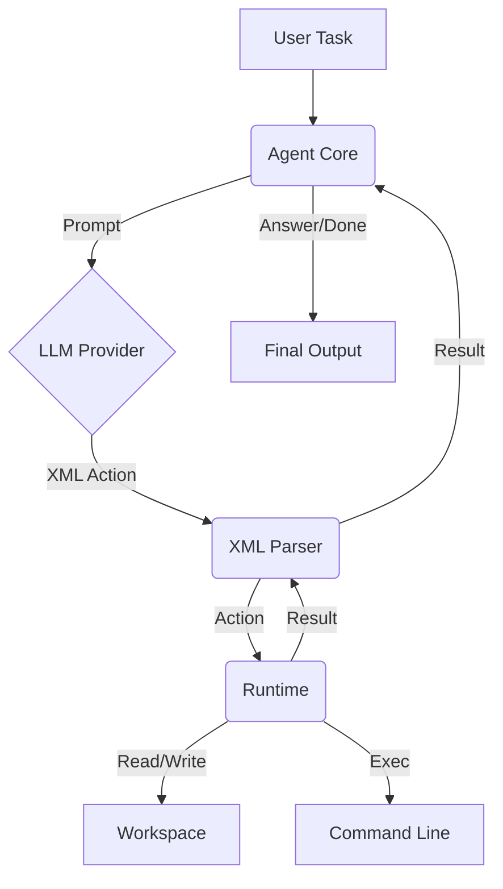

# XML Agent 快速上手指南

本文档旨在帮助新人快速理解项目架构、核心概念及开发流程。

## 1. 项目简介

XML Agent 是一个基于 Node.js 实现的工程型 AI Agent Framework。
**核心理念**：

- **LLM 负责思考**：理解任务、规划步骤。
- **Runtime 负责执行**：安全地操作文件系统、执行命令。
- **XML Action 负责通信**：Agent 与 Runtime 之间通过标准化的 XML 协议交互。
- **Workspace 负责目标环境**：所有操作限制在指定的工作目录内，确保安全。

当前版本：**1.1.0**

## 2. 核心架构



### 关键模块

- **Agent (`agent.js`, `agent-core.js`)**: 编排者，负责加载 Provider、构建 Prompt、解析 LLM 返回的 XML、调用 Runtime。
- **Runtime (`runtime.js`)**: 执行者，提供沙箱环境，处理 `read`, `write`, `exec` 等动作。
- **Provider (`providers/`)**: 模型后端适配器，支持 ChatGPT, Qwen, DeepSeek, GLM 等。
- **Plugins (`plugins/`)**: 扩展系统，支持新增 XML 动作、Hook、Provider 和 UI 面板。
- **WebUI (`webui/`)**: 基于 Vue3 的前端界面和 Express 后端服务。
- **Electron (`electron/`)**: 桌面应用封装。

## 3. 快速开始

### 3.1 环境要求

- Node.js >= 20.19
- Windows 10/11 (x64)
- Google Chrome 或 Microsoft Edge (用于 CDP 自动化)

### 3.2 安装与运行

```bash
git clone https://github.com/wulishuhan/xml_agent.git
cd xml_agent
npm install

# 启动 WebUI (推荐)
npm run webui
# 访问 http://localhost:3000/xml_agent_web/

# 命令行模式
node agent.js --workspace "D:\code\my-project" "创建一个简单的 Node.js Hello World 项目"
```

### 3.3 浏览器配置

Agent 通过 CDP (Chrome DevTools Protocol) 控制浏览器。

- **默认**: Edge (端口 9223)
- **切换**: 在 WebUI 右上角 Settings -> Browser Settings 中可切换为 Chrome (端口 9222)。
- **手动启动**:
    ```powershell
    & "C:\Program Files\Microsoft\Edge\Application\msedge.exe" --remote-debugging-port=9223 --user-data-dir="$PWD\edge-profile"
    ```

## 4. XML Action 协议

LLM 通过输出特定的 XML 标签来指令 Agent 执行操作。每次只能输出一个 Action。

### 内置动作

| 动作           | 描述                    | 示例                                                              |
| :------------- | :---------------------- | :---------------------------------------------------------------- |
| `<read>`       | 读取文件或目录          | `<read path="package.json"/>`                                     |
| `<write>`      | 写入文件 (自动创建目录) | `<write path="src/app.js"><![CDATA[console.log('hi');]]></write>` |
| `<exec>`       | 执行命令                | `<exec command="npm install"/>`                                   |
| `<screenshot>` | 截图 (插件提供)         | `<screenshot source="screen" path="shot.png"/>`                   |
| `<answer>`     | 返回最终答案            | `<answer><![CDATA[任务完成]]></answer>`                           |
| `<done/>`      | 结束任务                | `<done/>`                                                         |

### 插件动作 (v1.1.0+)

从 v1.1.0 起，支持通过插件新增自定义动作。例如内置的 `<fetch>` 动作：

```xml
<fetch url="http://127.0.0.1:3000/api" method="GET"/>
```

## 5. 插件系统

插件允许在不修改核心代码的情况下扩展 Agent 能力。

### 插件类型

1. **Action**: 新增 XML 动作 (如 `fetch`)。
2. **Hook**: 监听生命周期事件 (如 `audit-log` 记录审计日志)。
3. **Provider**: 新增模型后端支持。
4. **UI**: 声明式前端面板。

### 开发一个简单的 Action 插件

1. 创建目录 `~/.xml-agent/plugins/echo/`
2. `plugin.json`:
    ```json
    {
        "name": "echo",
        "version": "1.0.0",
        "kind": "action",
        "apiVersion": 1,
        "permissions": []
    }
    ```
3. `index.js`:
    ```js
    module.exports = {
        setup(ctx) {
            ctx.actions.register({
                name: "echo",
                schema: { attrs: { text: { type: "string", required: true } } },
                run(node, ctx) {
                    return { ok: true, action: "echo", text: ctx.attrs.text };
                },
                meta: {
                    prompt: { group: "plugin", usage: '<echo text="hello"/>' },
                },
            });
        },
    };
    ```
4. 重启服务或调用 `POST /api/plugins/reload`。

详细 API 参见 [PLUGIN_API.md](./PLUGIN_API.md) 和 [PLUGIN_DESIGN.md](./PLUGIN_DESIGN.md)。

## 6. 项目结构概览

xml_agent/
├── actions/ # 内置动作定义 (read/write/exec/answer/done)
├── plugins/ # 插件系统内核及内置插件
├── providers/ # 模型后端适配器
├── config/ # 配置管理 (schema.js 为单一来源)
├── parse/ # XML 解析器
├── prompts/ # 系统提示词构建
├── webui/ # Web 界面与服务端
│ ├── frontend/ # Vue3 前端
│ ├── routes/ # API 路由
│ └── server.js # Express 入口
├── electron/ # 桌面应用主进程
├── docs/ # 详细设计文档
└── test/ # 测试用例

## 7. 常用命令

```bash
# 代码格式化
npm run format

# 运行测试
npm run test:core       # 核心功能测试
npm run test:plugins    # 插件系统测试
npm run test:offline    # 离线测试套件

# Electron 开发
npm run electron:dev

# 构建安装包
npm run electron:build
```

## 8. 学习路径建议

1. **阅读 `readme.md`**: 了解整体功能和使用方法。
2. **阅读 `docs/PLUGIN_DESIGN.md`**: 深入理解架构设计、重构背景和插件系统原理。
3. **阅读 `docs/PLUGIN_API.md`**: 掌握插件开发的具体 API。
4. **查看 `plugins/builtin/`**: 参考内置插件 (`fetch`, `audit-log`, `screenshot`) 的实现。
5. **尝试编写一个插件**: 从最简单的 `echo` 插件开始。

## 9. 注意事项

- **安全边界**: Runtime 是安全边界，所有文件操作限制在 Workspace 内。
- **插件信任**: 插件拥有 Node.js 完整权限，请仅安装可信插件。
- **浏览器依赖**: 确保 Chrome/Edge 已安装且 CDP 端口未被占用。

---

_最后更新: 2026-11-02_
